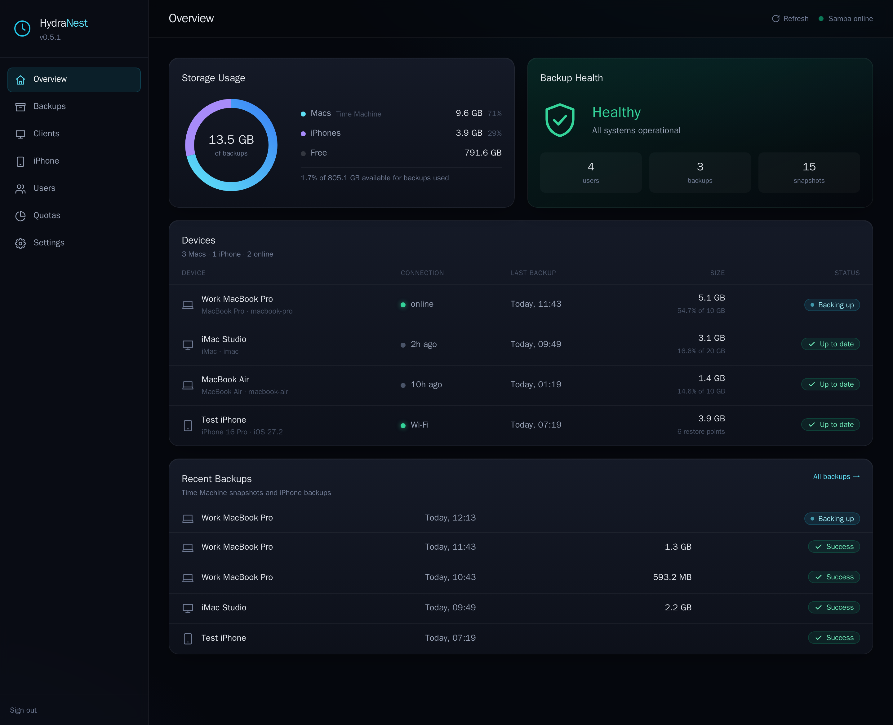
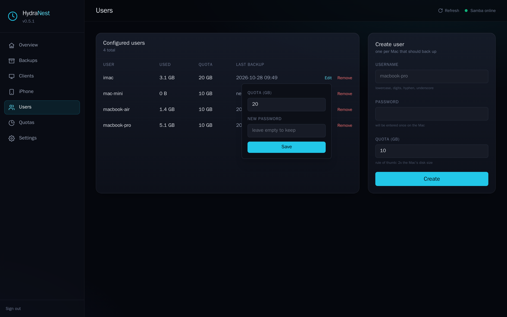
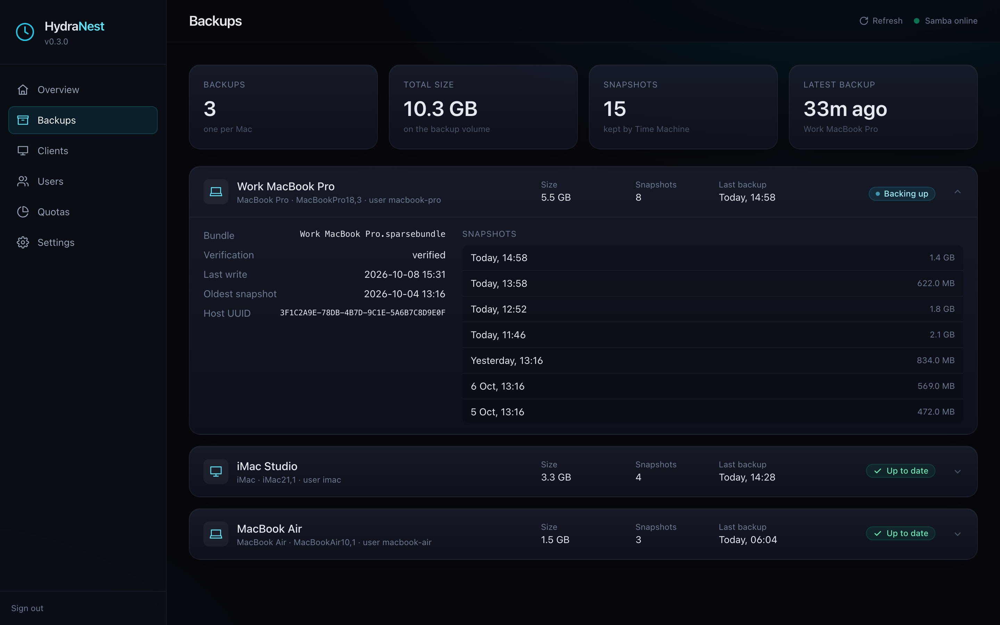
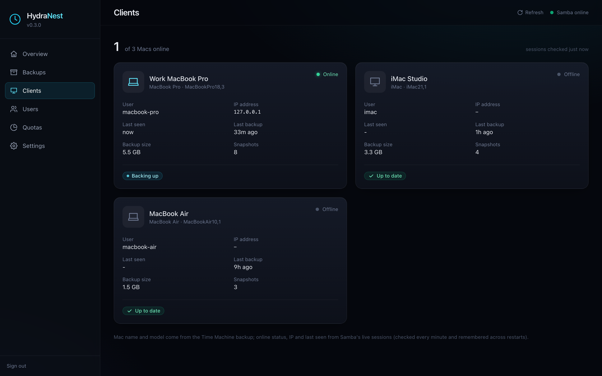
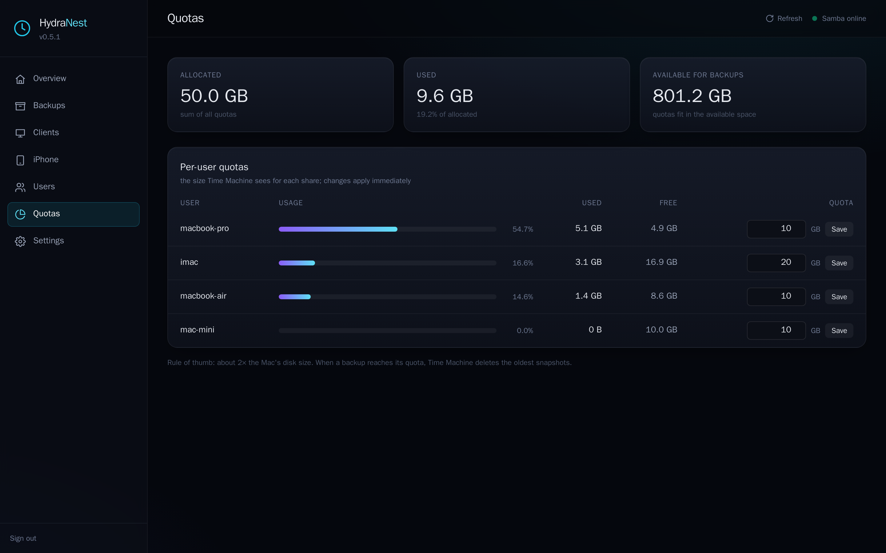
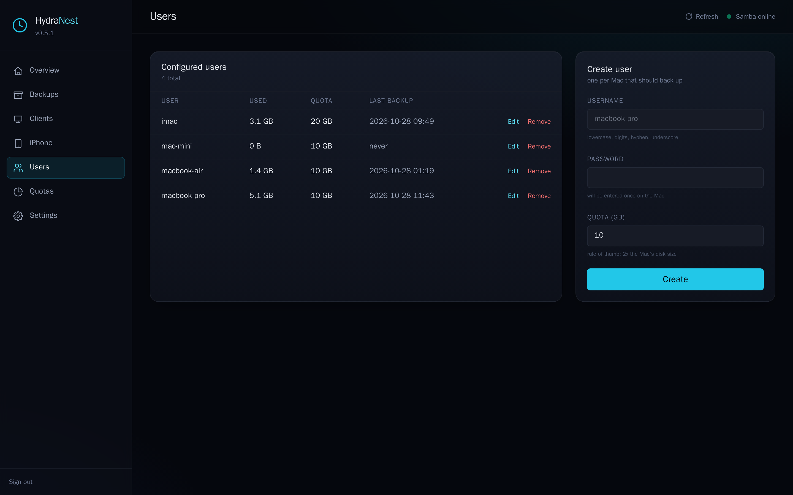
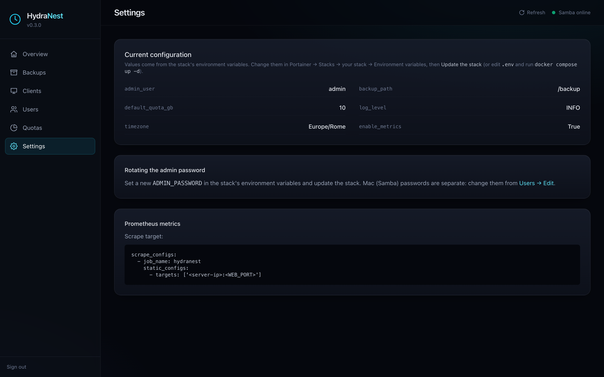
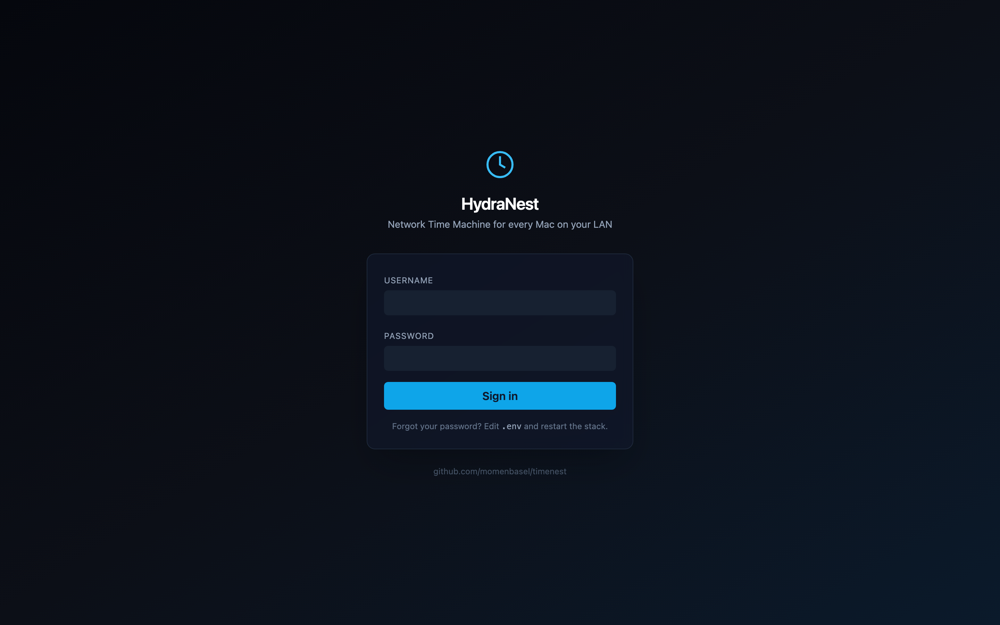

# HydraNest

**Network Time Machine server for every Mac on your LAN, deployed with Portainer.**

HydraNest turns a disk on a Linux / Proxmox / Docker host into a Time Machine
destination. It runs as one Docker stack:

| Container        | What it does                                                  |
| :--------------- | :------------------------------------------------------------ |
| `timenest-samba` | Samba 4 with `vfs_fruit`, one Time Machine share per user     |
| `timenest-avahi` | Bonjour/mDNS, so Macs find the server on their own            |
| `timenest-web`   | Admin web UI: overview, backups, Macs, iPhones, users, quotas |
| `hydranest-tailscale` | Tailscale node: the iPhone service's network             |
| `hydranest-iphone` | iPhone backups over USB, Wi-Fi and Tailscale ([iPhone backups](#iphone-backups)) |

HydraNest is a fork of [momenbasel/timenest](https://github.com/momenbasel/timenest).
It fixes the Samba and user-management problems found when running it on
Proxmox + Portainer. See [What the fork fixes](#what-the-fork-fixes) and the
[CHANGELOG](CHANGELOG.md).



---

## Deploy with Portainer

### 1. Prepare the folders on the host

```bash
mkdir -p /srv/hydranest/backups /srv/hydranest/data
```

Use any paths you like. `backups` holds the Time Machine data, `data` holds
HydraNest's own state (Samba accounts, per-user share files, web UI data).

### 2. Create the stack

Portainer -> **Stacks** -> **Add stack**, then either:

- **Repository**: URL `https://github.com/Sebaf-26/HydraNest`, compose path
  `docker-compose.yml`, or
- **Web editor**: paste [`docker-compose.yml`](docker-compose.yml).

The compose file only pulls prebuilt public images
(`ghcr.io/sebaf-26/hydranest-{samba,avahi,web,iphone}` and
`tailscale/tailscale`), nothing is built on the server.

### 3. Set the environment variables

```
BACKUP_PATH=/srv/hydranest/backups
DATA_PATH=/srv/hydranest/data
SERVER_NAME=TimeNest
DEVICE_MODEL=TimeCapsule8,119
ADMIN_USER=admin
ADMIN_PASSWORD=<strong password>
DEFAULT_QUOTA_GB=1000
TIMEZONE=Europe/Rome
LOG_LEVEL=INFO
ENABLE_METRICS=true
SMB_INTERFACES=eth0
WEB_PORT=8003
```

plus the iPhone variables, see [iPhone backups](#iphone-backups).

In Portainer, `BACKUP_PATH` and `DATA_PATH` **must be absolute paths**.
Relative paths would point inside Portainer's own data directory.

### 4. Deploy

Click **Deploy the stack** and open `http://<server-ip>:<WEB_PORT>`.

> **Coming from a TimeNest stack?** Delete the old stack first (the container
> names are the same, so the two can't run together). Your data lives in the
> host folders, so removing the stack doesn't touch it. Keep the same
> `BACKUP_PATH` / `DATA_PATH` and **don't mount a patched
> `entrypoint-samba.sh` any more**: the fixes are in the images.

### Updating

Portainer -> the stack -> **Update the stack** with **Re-pull image** enabled.

---

## Variables

| Variable           | Default            | What it does |
| :----------------- | :----------------- | :----------- |
| `BACKUP_PATH`      | required           | Host folder for the Time Machine backups (one subfolder per user) |
| `DATA_PATH`        | `./data`           | Host folder for HydraNest state: `samba/` (accounts), `config/shares.d/` (one `<user>.conf` per user), `web/` |
| `ADMIN_PASSWORD`   | required           | Web UI password |
| `ADMIN_USER`       | `admin`            | Web UI username |
| `WEB_PORT`         | `8080`             | Host port of the web UI. Change it if you get "port is already allocated" |
| `SERVER_NAME`      | `TimeNest`         | Name shown in Finder and Time Machine. Changing it later means re-selecting the disk on each Mac |
| `DEVICE_MODEL`     | `TimeCapsule8,119` | Model advertised to macOS (Finder icon). Also `Xserve`, `MacPro7,1`, `Macmini9,1` |
| `DEFAULT_QUOTA_GB` | `500`              | Quota pre-filled when creating a user |
| `SMB_INTERFACES`   | empty (all)        | Interfaces Samba binds to, e.g. `eth0`. Check with `ip -br addr` on the host |
| `TIMEZONE`         | `UTC`              | e.g. `Europe/Rome` |
| `LOG_LEVEL`        | `INFO`             | `DEBUG`, `INFO`, `WARNING`, `ERROR` |
| `ENABLE_METRICS`   | `true`             | Prometheus `/metrics` on the web UI port |

Samba and Avahi use `network_mode: host`: SMB is on port 445 of the host and
Bonjour announcements reach the LAN directly.

The iPhone variables (`IPHONE_*`, `TS_*`) are listed under
[iPhone backups](#iphone-backups).

---

## iPhone backups

The `iphone` service backs up iPhones to the server: at home over USB or
Wi-Fi like Finder, and **away from home through Tailscale**. It is a
modified [AirVault](https://github.com/wizier/airvault) under GPL-3.0, kept
in [`iphone/`](iphone/) (see [iphone/NOTICE.md](iphone/NOTICE.md)).

It runs inside the network of the `tailscale` container, which has two
legs: an address on a macvlan network on the iPhones' LAN, where the phones
are found by Bonjour, and a Tailscale node. Each iPhone's page has a
**Remote access (Tailscale)** field: with its Tailscale address there,
HydraNest asks netmuxd to reach the phone at that address on start, every
minute and after a change, whenever Bonjour can't see it.

It all lives in the one HydraNest UI and login: the **iPhone** page shows
the iPhone section inside the HydraNest layout (the web container proxies it
under `/iphone/app/` and signs in with `IPHONE_AUTH_TOKEN`), and the iPhones
appear in **Overview** and **Backups** next to the Macs, with their state in
Backup Health.

> **Wi-Fi is required, cellular is not enough.** iOS only opens the
> backup/sync service while the iPhone is on a Wi-Fi network. Away from home
> any Wi-Fi works (office, hotel) with Tailscale on; on mobile data alone
> the phone answers Tailscale but refuses the connection (tested on iOS 27.2).

### Before the first deploy

- **A macvlan network on the iPhones' LAN**, created outside the stack (in
  Portainer: Networks -> Add network, driver `macvlan`, parent = the host's
  interface on that LAN, its subnet and gateway). Pick a free address on it
  for `IPHONE_IP`.
- **`/dev/net/tun` on the host.** In a Proxmox LXC, add to
  `/etc/pve/lxc/<id>.conf` and restart the container:
  `lxc.mount.entry: /dev/net/tun dev/net/tun none bind,create=file`
  (plus `lxc.cgroup2.devices.allow: c 10:200 rwm` if the LXC does not
  already allow all devices).
- **A Tailscale auth key** (admin console -> Settings -> Keys), one-off is
  enough: the node's state is kept in `DATA_PATH/tailscale`, so the key is
  only used on the first start. Afterwards, in Machines, **disable key
  expiry** for `hydranest-iphone`, or it drops off the tailnet after
  180 days. If you use ACLs, let it reach the iPhones on every TCP port
  (iOS opens its services on random ports).
- **The Tailscale app on each iPhone**, signed in to the same tailnet and
  left connected.

### Variables

| Variable             | Default            | What it does |
| :------------------- | :----------------- | :----------- |
| `IPHONE_NETWORK`     | `airvault_net`     | Existing macvlan network on the iPhones' LAN |
| `IPHONE_IP`          | required           | Free address on it; the iPhone Web UI is at `http://IPHONE_IP:IPHONE_PORT` |
| `IPHONE_PORT`        | `8089`             | iPhone Web UI port |
| `IPHONE_CONFIG_PATH` | required           | Host folder for settings, database and pairing records (AirVault's `/config`) |
| `IPHONE_BACKUP_PATH` | required           | Host folder for the iPhone backups (AirVault's `/backups`) |
| `IPHONE_AUTH_TOKEN`  | empty              | iPhone service token, used by HydraNest to open the iPhone section for you; set it (when empty the `iphone` container prints a generated one in its log and the iPhone page asks for it) |
| `IPHONE_URL`         | empty              | The `iphone` service as the web container reaches it, e.g. `http://192.168.20.10:8089` (its macvlan address: the request goes through your router to that LAN). Empty hides the iPhone section |
| `TS_AUTHKEY`         | empty              | Tailscale auth key, first start only. Empty: the log of `hydranest-tailscale` shows a login link instead |
| `IPHONE_TS_HOSTNAME` | `hydranest-iphone` | Machine name on the tailnet |
| `TS_EXTRA_ARGS`      | empty              | Extra `tailscale up` flags, e.g. `--advertise-tags=tag:hydranest` |
| `IPHONE_LOG_LEVEL` / `IPHONE_MUX_LOG_LEVEL` | `info` / `warn` | Daemon and USB/Wi-Fi muxer logs; `debug` for diagnosis |

### Pairing and remote access

1. Open **iPhone** in the HydraNest menu and click **Pair device** with the iPhone connected **over USB** to the
   server, once: the iPhone asks to trust the computer. After that the cable
   is no longer needed.
2. In the iPhone's page, under **Remote access (Tailscale)**, enter its
   Tailscale IP (`100.x.y.z`, shown in the Tailscale app or admin console)
   or its full MagicDNS name (`iphone.<tailnet>.ts.net`) and save. The card
   shows whether the phone is reachable.
3. **Automatic backup** (same page) works the same at home and away: about
   5 seconds after the iPhone is unlocked on Wi-Fi the backup starts, and
   iOS asks for the passcode.

### Coming from an AirVault stack

Set `IPHONE_CONFIG_PATH` and `IPHONE_BACKUP_PATH` to the old stack's
`/config` and `/backups` folders: pairings, settings and restore points
carry over, nothing needs re-pairing. **Stop the old stack first**: two
daemons on the same folders (and the same USB bus) would corrupt the
database. Delete it only once the new service works.

---

## Users

Create **one user per Mac** in the web UI (**Users** -> **Create user**) with
a password and a quota. Each user gets:

- a Samba account (stored in `DATA_PATH/samba/passdb.tdb`),
- a share file `DATA_PATH/config/shares.d/<user>.conf`,
- a backup folder `BACKUP_PATH/<user>`.

**Edit** on a user changes the quota and, optionally, the password. Changes
apply immediately, no restart needed. **Remove** deletes the account and the
share but **keeps the backup data** in `BACKUP_PATH/<user>`.

The quota is the size Time Machine sees for that share
(`fruit:time machine max size`). It is not a filesystem quota.



## Connecting a Mac

1. **System Settings -> General -> Time Machine -> Add Backup Disk**.
2. Pick the server (`SERVER_NAME`) and the share with the user's name.
3. Sign in with the HydraNest user and password (not your macOS password).
4. Enable backup encryption (recommended).

If the server doesn't appear, in Finder use **Go -> Connect to Server**
`smb://<server-ip>/<user>` once, then retry from Time Machine.

---

## Web UI

| Page | What it shows |
| :--- | :------------ |
| **Overview** | Backup space donut (backups vs. free space; other data on the volume is ignored), backup health, connected Macs, top users by quota usage, recent Time Machine snapshots |
| **Backups** | One card per Mac backup: model, size, snapshot count and list, verification state, last write |
| **Clients** | Every Mac: online/offline, IP, last seen, last backup, status (up to date, backing up, overdue) |
| **Users** | Create, edit (quota and password), remove |
| **Quotas** | Usage bar per user, free space, inline quota edit, warning when quotas exceed the disk |
| **Settings** | Current configuration and Prometheus target |

All data is real: Mac name and model come from the Time Machine bundle
(`<Mac>.sparsebundle` and its `com.apple.TimeMachine.*.plist` files),
snapshots from `SnapshotHistory.plist`, online status and IP from Samba's live
sessions. The web container polls Samba every minute and remembers when each
Mac was last seen (`DATA_PATH/web/clients.json`). **Backup health** turns
amber when a Mac hasn't completed a backup in 7 days, a user is above 90% of
the quota, or the space available for backups is above 90% used, and red when Samba is down or the
backup volume is missing.

| Backups | Clients |
| :-: | :-: |
|  |  |
| **Quotas** | **Users** |
|  |  |
| **Settings** | **Login** |
|  |  |

---

## Troubleshooting

```bash
# Startup log: restored users and loaded share files
docker logs timenest-samba --tail 50

# Is a user's share loaded?
docker exec timenest-samba testparm -s 2>/dev/null | grep -A20 '^\[sebaf\]'

# Interfaces Samba listens on
docker exec timenest-samba testparm -s 2>/dev/null | grep interfaces

# Samba accounts and POSIX user
docker exec timenest-samba pdbedit -L
docker exec timenest-samba id sebaf

# Share files on the host
ls -la /srv/hydranest/data/config/shares.d/

# SMB login test
docker exec -it timenest-samba smbclient //127.0.0.1/sebaf -U sebaf -c ls

# Web UI log
docker logs timenest-web --tail 100
```

| Symptom | Meaning / fix |
| :------ | :------------ |
| `NT_STATUS_LOGON_FAILURE` | Wrong username/password. Reset it with **Edit** in the web UI |
| `NT_STATUS_BAD_NETWORK_NAME` | Login worked but the share is not loaded: check that `<user>.conf` exists in `shares.d` and appears in `testparm -s` |
| Web UI shows **0 users** | The web container doesn't see `shares.d`: `DATA_PATH` must be the same for all services (it is, if you use this compose file unchanged) |
| `port is already allocated` | Change `WEB_PORT` |
| `container name "/timenest-samba" is already in use` | An old TimeNest stack is still running: delete it (data stays on the host) |
| Mac doesn't see the server | Avahi must run with host networking; on the Mac, `dns-sd -B _smb._tcp` should list it |

---

## What the fork fixes

| Problem in TimeNest | Fix in HydraNest |
| :------------------ | :--------------- |
| `smbd` exits at start: `Invalid option --log-stdout` (Samba 4.17) | The entrypoint uses `--debug-stdout` or `--log-stdout`, whichever the installed Samba supports |
| Share not loaded (`BAD_NETWORK_NAME`): Samba ignores the wildcard in `include = .../shares.d/*.conf` | One explicit `include` per user is generated at startup and on every user change |
| Users stop working after a redeploy (POSIX users lived only inside the container) | Users are recreated at startup with their original UID/GID |
| Mounting `/etc/timenest` hid the templates (`smb.conf.template: No such file`) | Templates moved to `/usr/share/timenest`; only `shares.d` is mounted |
| Web UI shows 0 users | The web container reads the same `shares.d` as Samba (`SHARES_PATH`) |
| Quota and password could only be changed by hand | **Edit** button in the web UI |
| `interfaces = lo` rendered when `SMB_INTERFACES` is empty | The line is omitted |

---

## Without Portainer

```bash
git clone https://github.com/Sebaf-26/HydraNest.git && cd HydraNest
cp .env.example .env    # set BACKUP_PATH, ADMIN_PASSWORD, ...
docker compose up -d
```

`./install.sh` does the same interactively on Debian/Ubuntu/Raspberry Pi OS.
For development, build the images locally as described in
[CONTRIBUTING.md](CONTRIBUTING.md).

## Monitoring

With `ENABLE_METRICS=true`, `http://<server>:<WEB_PORT>/metrics` exposes
`timenest_users_total`, `timenest_sessions_active`,
`timenest_backup_bytes_used`, `timenest_backup_quota_bytes`,
`timenest_last_backup_timestamp_seconds`, `timenest_disk_total_bytes`,
`timenest_disk_free_bytes`.

## Security

- Don't expose port 445 or the web UI to the internet. For remote backups use a VPN (WireGuard, Tailscale).
- The iPhone Web UI is reachable on the tailnet too (`http://hydranest-iphone:<IPHONE_PORT>`): set `IPHONE_AUTH_TOKEN` to a strong value. Never commit `TS_AUTHKEY` or the token.
- SMB1 is disabled, SMB signing is mandatory.
- The web container mounts `/var/run/docker.sock` to manage Samba users via `docker exec`: treat the web UI password like root access to the host.

## License

The two parts of the repository have different licenses:

- Everything except `iphone/`: MIT, like the original project. See
  [LICENSE](LICENSE). Original work © momenbasel/timenest contributors.
- [`iphone/`](iphone/) and the `hydranest-iphone` image: GNU GPL v3.0 or
  later, as the [AirVault](https://github.com/wizier/airvault) code it is
  based on. See [iphone/LICENSE](iphone/LICENSE) and
  [iphone/NOTICE.md](iphone/NOTICE.md) for what HydraNest changed.
